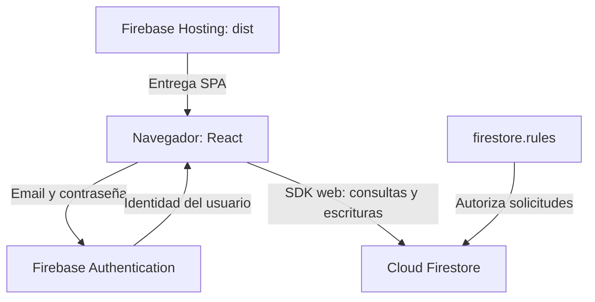

# Arquitectura

[Índice](README.md) · [Modelo de datos](data-model.md) · [Seguridad](security.md)

## Vista de ejecución

La comunicación con Firebase parte del navegador. El repositorio no contiene un servidor de aplicación intermedio. Las reglas se evalúan en Firestore; ocultar una acción en React no sustituye la autorización.

## Responsabilidades del código

| Archivo | Responsabilidad comprobada |
| --- | --- |
| [src/main.jsx](../src/main.jsx) | Montaje con `createRoot`; componente `App`; autenticación, perfil, navegación, suscripciones, formularios, demo, métricas y administración |
| [src/firebase.js](../src/firebase.js) | Evalúa `configured`; inicializa Firebase, Auth y Firestore cuando existen cuatro variables obligatorias |
| [src/data.js](../src/data.js) | `listen`, `saveProduct`, `moveStock`, `saveCategory`; consultas por propietario y transacciones |
| [src/config.js](../src/config.js) | Nombre, formato ARS y fechas, `nextStock`, CSV y mensajes de error |
| [src/ImagePicker.jsx](../src/ImagePicker.jsx) | Selección de imagen, vista previa, eliminación del valor y estado de procesamiento |
| [src/images.js](../src/images.js) | `prepareImage`: validación de archivo y conversión mediante canvas |
| [firestore.rules](../firestore.rules) | Autorización por identidad, rol, estado, propietario y validación de documentos |
| [firebase.json](../firebase.json) | Hosting de `dist`, reescritura SPA, tres cabeceras y emulador Firestore en 8080 |
| [vite.config.js](../vite.config.js) | Plugins React/Tailwind y separación de chunks de React, Auth y Firestore |

## Sesión y lectura reactiva

`onAuthStateChanged` actualiza el usuario. Una suscripción al documento `users/{uid}` determina el perfil. Si falta, la interfaz ofrece completarlo; si está suspendido, muestra un bloqueo. Un perfil activo habilita tres suscripciones: productos, categorías y movimientos.

`listen(type, uid, ...)` usa `where("ownerId", "==", uid)` cuando recibe UID. La lectura de cuentas del administrador usa `listen("users", null, ...)`, sin ese filtro. Al consultar otra cuenta, `selected.id` pasa a ser el propietario consultado. Los efectos devuelven las funciones de cancelación de las suscripciones.

Los filtros de búsqueda, categoría y archivo se aplican en memoria. No hay paginación ni límites de consulta en `listen`: se reciben listas completas, incluidas las miniaturas almacenadas en cada documento.

## Escritura y consistencia

`saveProduct` crea producto y movimiento inicial en una transacción. Editar un producto existente usa `updateDoc` y no permite cambiar su cantidad desde el formulario.

`moveStock` lee de nuevo el producto dentro de `runTransaction`, rechaza un documento inexistente o archivado, calcula el resultado con `nextStock` y escribe cantidad e historial juntos. Véase el [diagrama de secuencia](user-flows.md#registrar-un-movimiento).

Esto describe la atomicidad del cliente oficial. Las reglas no exigen que toda modificación de cantidad incluya un movimiento ni comprueban su correspondencia matemática.

## Navegación real

| Vista interna | URL escrita por `navigate` |
| --- | --- |
| Resumen, Productos, Movimientos, Categorías | `/` |
| Administración | `/admin` |
| Privacidad | `/privacy` |

No se usa una biblioteca de routing. El estado inicial reconoce `/admin`; la condición de renderizado también reconoce `/privacy`. `popstate` reconoce ambas rutas y vuelve a Resumen para el resto. Por eso Productos, Movimientos y Categorías no tienen enlaces profundos propios y recargar `/` vuelve a Resumen. Hosting reescribe las solicitudes a `/index.html`.

## Imágenes y demo

`prepareImage` admite JPEG, PNG o WebP de hasta 8 MiB. Decodifica, pinta sobre fondo blanco y reexporta JPEG con calidad 0,72; intenta lados máximos de 384, 256 y 160 píxeles hasta obtener como máximo 64.000 caracteres. No amplía imágenes pequeñas. Guarda un data URL en `users.photo` o `products.image`; no utiliza el bucket aunque exista una variable de configuración para él.

`startDemo` carga cuatro productos, dos categorías y ningún movimiento. Las operaciones usan estados React y se pierden al recargar. El flujo de demo evita las operaciones de datos y autenticación de la cuenta ficticia; si Firebase está configurado, su inicialización y el observador de autenticación se instalan igualmente. La demo no debe presentarse como una réplica exacta de la persistencia real: sus registros de movimientos no tienen todos los metadatos de Firestore.

