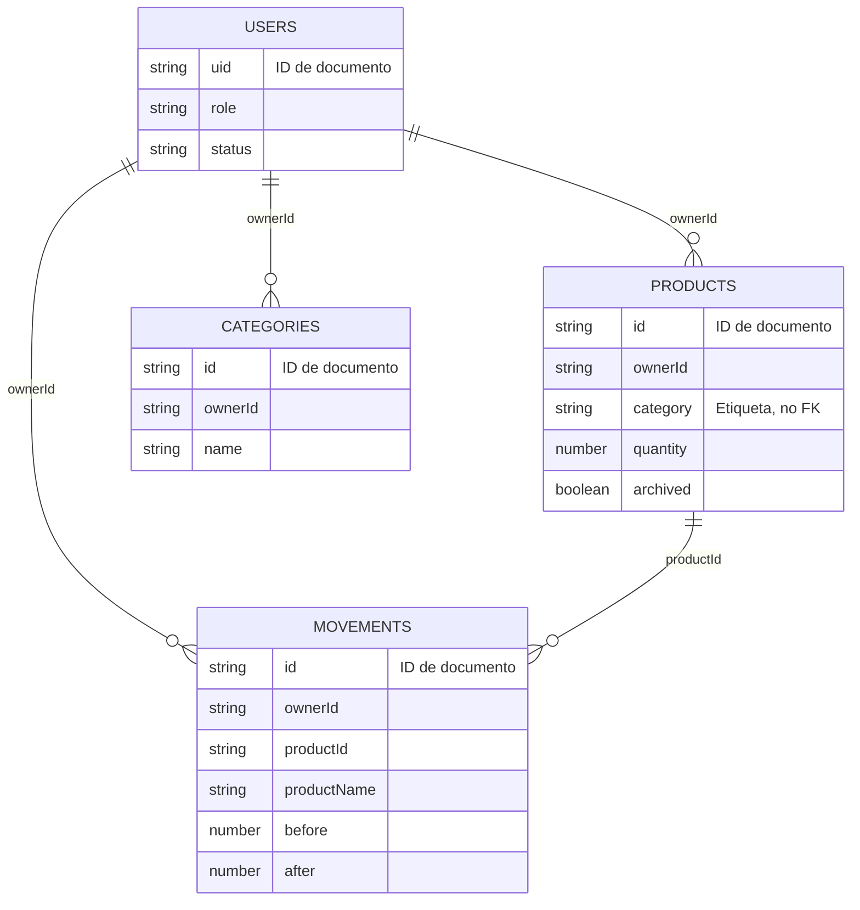

# Modelo de datos de Firestore

[Índice](README.md) · [Seguridad](security.md)

Fuentes normativas de esta descripción: [firestore.rules](../firestore.rules), [data.js](../src/data.js), `saveProduct`, `moveStock`, `saveCategory`, y [main.jsx](../src/main.jsx), `authenticate` / `submitModal`. Todos los campos siguientes son obligatorios salvo los marcados como opcionales.

## Colecciones y relaciones lógicas



Son **cuatro colecciones raíz**, no subcolecciones. Las relaciones del diagrama describen la intención del cliente oficial; Firestore y las reglas de este repositorio no imponen claves foráneas. En particular, las reglas de movimientos no verifican existencia, propietario ni cantidad del producto referenciado. `products.category` es texto y no apunta al ID de `categories`.

`listen` agrega `id: d.id` a cada objeto leído. Ese ID de interfaz no se persiste como campo del documento. El ID de `users` coincide con el UID de Auth; productos, categorías y movimientos reciben IDs automáticos al crear referencias.

## users/{uid}

| Campo | Tipo | Regla y uso |
| --- | --- | --- |
| name | string | No vacío; máximo 120 caracteres |
| business | string | No vacío; máximo 120; nombre visible del negocio |
| email | string | Al crear, igual al email del token Auth |
| role | string | Alta del cliente solo `user`; `admin` reconocido para autorización |
| status | string | Alta solo `active`; administrador puede alternar otra cuenta entre `active` y `suspended` |
| createdAt | timestamp | Al crear igual a `request.time`, enviado con `serverTimestamp()` |
| photo | string, opcional | Vacío o data URL JPEG conforme a la regla de imágenes |

El propietario activo puede actualizar solamente nombre, negocio y foto. Ni email, rol ni fecha de alta son editables por el cliente. No se autoriza borrar el perfil.

## products/{id}

| Campo | Tipo | Restricción |
| --- | --- | --- |
| ownerId | string en el cliente | Debe coincidir con UID activo al crear; inmutable al actualizar |
| name | string | De 1 a 160 caracteres |
| sku | string | De 1 a 80 caracteres |
| category | string | Hasta 100; admite vacío |
| description | string | Hasta 1.000; admite vacío |
| cost | number | Entre 0 y 1.000.000.000 |
| price | number | Entre 0 y 1.000.000.000 |
| quantity | number | Entre 0 y 1.000.000.000 |
| minimum | number | Entre 0 y 1.000.000.000 |
| archived | boolean | `false` al crear desde la app |
| createdAt | timestamp | Fecha del servidor al crear; inmutable al actualizar |
| image | string, opcional | Vacío o data URL JPEG conforme a la regla de imágenes |

Las reglas admiten números fraccionarios. El SKU se compara sin distinguir mayúsculas en `submitModal` contra los productos cargados, incluidos archivados; no hay índice de unicidad ni validación equivalente en reglas. Dos altas concurrentes pueden repetirlo.

## categories/{id}

| Campo | Tipo | Restricción |
| --- | --- | --- |
| ownerId | string en el cliente | Igual al UID activo al crear; inmutable al actualizar |
| name | string | De 1 a 100 caracteres |

No hay fechas ni otros campos permitidos. El cliente comprueba nombres duplicados sin distinguir mayúsculas, pero las reglas no garantizan unicidad. Renombrar o eliminar una categoría no cambia `products.category`; los productos conservan su etiqueta.

## movements/{id}

| Campo | Tipo | Restricción y significado |
| --- | --- | --- |
| ownerId | string en el cliente | Igual al UID del creador activo |
| productId | string | Hasta 128; referencia lógica al producto |
| productName | string | Hasta 160; nombre copiado al registrar |
| type | string | `inicial`, `entrada`, `salida`, `ajuste` |
| amount | number | Entre 0 y 1.000.000.000; en ajuste es el saldo final |
| before | number | Entre 0 y 1.000.000.000 |
| after | number | Entre 0 y 1.000.000.000 |
| reason | string | De 1 a 500 caracteres |
| date | string | Hasta 40; el cliente genera ISO a partir de la fecha elegida |
| createdAt | timestamp | Igual a `request.time` al crear |

`date` representa la fecha de la operación elegida por el usuario; `createdAt` registra su creación en Firestore. El historial se ordena por `date` en el cliente y Resumen muestra cinco registros recientes. Las reglas no comprueban que `date` sea ISO ni que `before`, `after` y `amount` satisfagan la fórmula del tipo.

El nombre es una instantánea: renombrar un producto no modifica movimientos previos. No se autorizan actualizaciones ni eliminaciones de movimientos desde clientes sujetos a estas reglas.

## Reglas comunes y ejemplo

Los validadores usan listas de campos permitidos y obligatorios; los campos adicionales se rechazan. La regla de imagen acepta vacío o una cadena de hasta 64.000 caracteres con prefijo `data:image/jpeg;base64,` y caracteres base64. Valida formato textual, no la decodificación real del JPEG.

Ejemplo ficticio de una salida, omitiendo deliberadamente `createdAt` porque lo asigna el servidor al escribir:

```json
{
  "ownerId": "uid-ejemplo",
  "productId": "producto-ejemplo",
  "productName": "Yerba mate",
  "type": "salida",
  "amount": 2,
  "before": 10,
  "after": 8,
  "reason": "Venta de mostrador",
  "date": "2026-11-12T15:00:00.000Z"
}
```

Este fragmento es explicativo, no un documento completo listo para importar.

