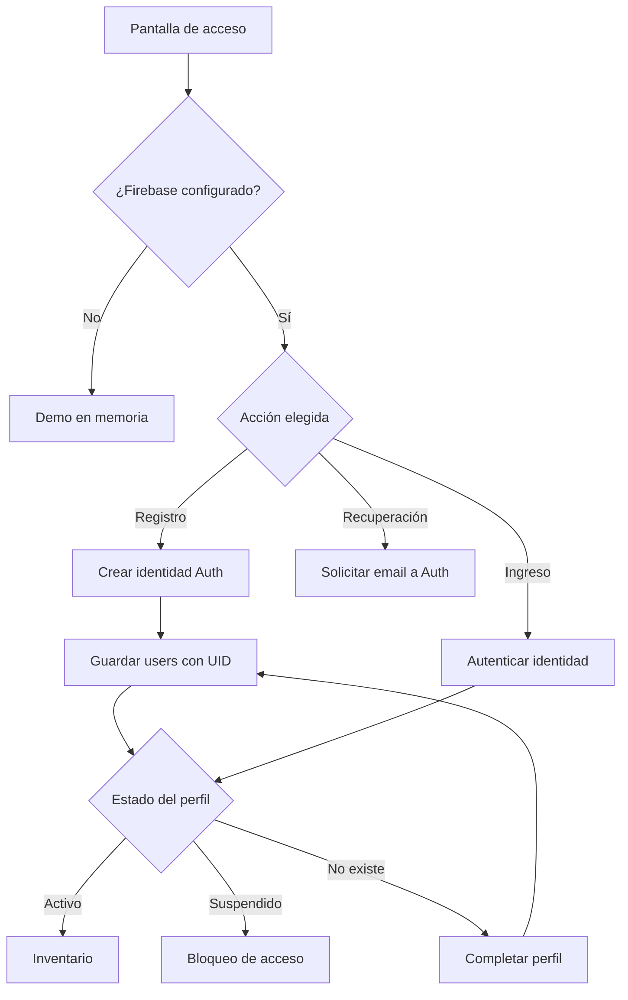
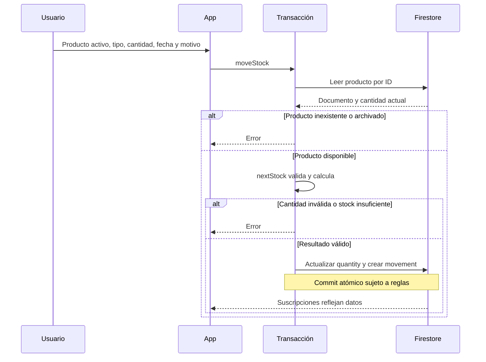
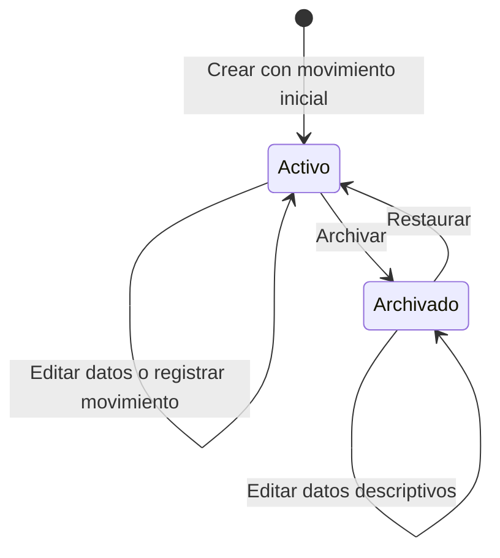
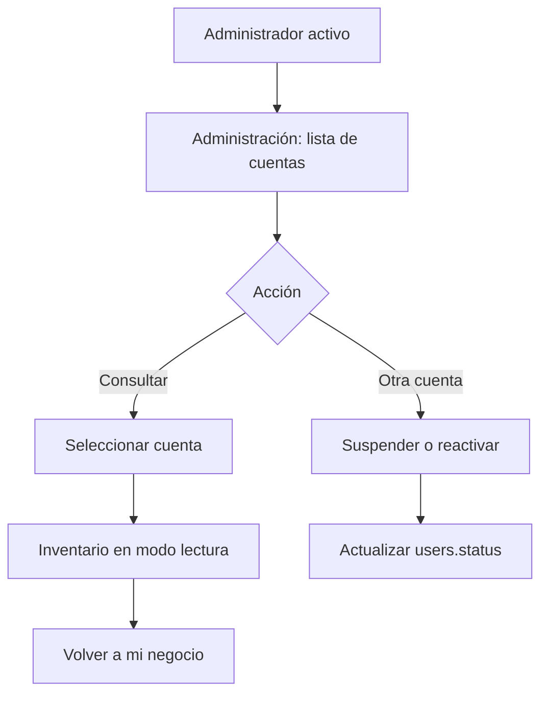

# Flujos de usuario

[Índice](README.md) · [Manual](user-guide.md)

## Registro y acceso

Fuentes: [main.jsx](../src/main.jsx), `authenticate`, efectos de sesión y perfil, y ramas `profile.missing` / `profile.status`; [firebase.js](../src/firebase.js), `configured`.

El registro son dos operaciones separadas: crear identidad en Auth y guardar el perfil. No es una transacción entre servicios. Si la segunda falla, el usuario autenticado puede completar su perfil. El mensaje de recuperación se muestra al resolver la llamada al SDK; no prueba la recepción del correo. No hay flujo de verificación de email implementado.

## Registrar un movimiento

Fuentes: [data.js](../src/data.js), `moveStock`; [config.js](../src/config.js), `nextStock`; [main.jsx](../src/main.jsx), `submitModal`. El diagrama representa el modo Firebase. En demo no existe transacción remota.

| Tipo | Cálculo | Ejemplo ficticio desde 10 unidades |
| --- | --- | --- |
| Entrada | actual + cantidad | 3 → 13 |
| Salida | actual − cantidad | 3 → 7 |
| Ajuste | cantidad como saldo final | 3 → 3 |
| Inicial | cantidad inicial del producto nuevo | Desde 0 a la cantidad elegida |

Entrada y salida deben ser mayores que cero; ajuste permite cero. Se rechazan resultados negativos o superiores a 1.000.000.000. El cálculo redondea a seis decimales; los formularios numéricos declaran paso 0,01.

## Ciclo del producto

No hay borrado de productos en el cliente ni autorización de borrado en reglas. La edición sigue disponible en la lista de archivados; el selector de movimientos incluye solo activos. Archivar cambia `archived`, sin generar un movimiento ni alterar la cantidad. Fuentes: [main.jsx](../src/main.jsx), tabla de productos y formulario de movimientos; [firestore.rules](../firestore.rules), `products`.

## Consulta administrativa

La consulta cambia el UID de las suscripciones. `readOnly = !!selected` oculta altas y cambios comerciales. Las reglas permiten al administrador leer documentos ajenos y cambiar únicamente el estado de otro perfil, sin privilegio general para editar inventarios ajenos. El administrador conserva sus permisos de propietario sobre su propio inventario.

Suspender no elimina la identidad de Firebase Auth: bloquea el acceso comercial por estado en Firestore y en la interfaz. El panel no permite auto suspensión ni cambio de roles. Fuentes: [main.jsx](../src/main.jsx), `selected`, `readOnly`, bloque Administración; [firestore.rules](../firestore.rules), `admin` y `users`.

